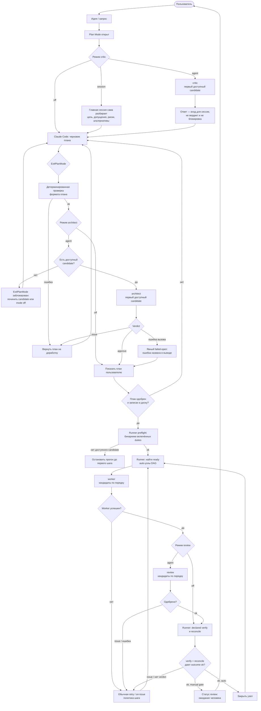

# Спека: модели, роли и поставщики

## routing — Маршрутизация обязанностей

part: требования
refs: tasks#fields

- Модель выбирается глобально по обязанности жизненного цикла, а не в задаче:
  `critic`, `architect`, `worker`, `review`, `retro`. Полей `agent`, `provider`
  и `model` у задачи нет, поэтому смена модели не требует переписывать доску.
- У обязанности упорядоченный непустой список `candidates`; кандидат — это
  `{provider, model, reasoning_effort?}`. Первый доступный кандидат выполняет
  вызов. Именованных пулов и отдельного редактора пулов нет: UI показывает в
  строке обязанности основной кандидат и резерв, CLI `agents list` печатает
  весь порядок через `->`.
- У каждой обязанности одно поле `mode` — кто её выполняет. Допустимые
  значения объявлены по обязанностям: `critic` — `off | session | agent`;
  `architect` и `review` — `off | agent`; `worker` — только `always`; `retro` —
  только `agent`. `off` — прохода нет; `session` — его делает главная сессия без
  второго модельного вызова; `agent` и `always` проходят список кандидатов.
- Стартовая карта ставит Anthropic первым, OpenAI резервом у каждой обязанности:
  `critic` — `session`, Sonnet → Terra; `architect` — `agent`, Opus → Terra;
  `worker` — `always`, Sonnet → Sol; `review` — `agent`, Opus → Terra;
  `retro` — `agent`, Sonnet → Sol. Reasoning effort стартового OpenAI-резерва:
  `high` у critic/architect/review, `medium` у worker/retro.
- Provider и модель выбираются связанными списками. UI, CLI и мигратор не
  сохраняют невозможные пары вроде `openai/claude-opus-5-5`.
- Каждая строка настроек показывает полный id модели и окрашивает его по
  семейству.
- Задача может нести свойство самой работы — `risk: high` (см. `tasks#process-language`),
  но не то, кто её выполняет: полей `agent`/`provider`/`model` на задаче как не
  было, так и нет. Маршрутизация по риску живёт отдельно от обязанностей, в
  верхнеуровневом ключе `agents.json`: `routes.high.<duty>` — такой же
  упорядоченный список кандидатов. Когда узел объявляет `risk: high` и для
  нужной обязанности задан непустой валидный список, он целиком заменяет
  обычных кандидатов; `mode`, `role` и `instructions` остаются от обязанности.
  Нет маршрута — используется обычный список, а исход отражается в
  `route.note`, а не теряется молча.
- UI ключ `routes` пока не редактирует: `saveAgentProfiles` перезаписывает
  только ключ `duties` через Tauri store, `routes` остаётся нетронутым и
  правится вручную прямо в `agents.json`.

## profiles — Настраиваемые роли

part: устройство

Карта версии 5 лежит в локальном Tauri store с именем `agents.json` в каталоге
приложения, отдельно от settings.json: UI и CLI не переписывают
один файл конкурентно.
Ею управляет `cli agents`; стартовую карту можно восстановить командой
`cli agents init --force` или кнопкой в UI.

Сокращённый фрагмент формы записи (в валидном v5 обязательны все duties):

```json
{
  "version": 5,
  "duties": {
    "worker": {
      "mode": "always",
      "candidates": [
        { "provider": "anthropic", "model": "claude-sonnet-5-5" },
        { "provider": "openai", "model": "gpt-5.6-sol", "reasoning_effort": "medium" }
      ]
    }
  },
  "routes": {
    "high": {
      "worker": [{ "provider": "openai", "model": "gpt-5.6-sol", "reasoning_effort": "high" }]
    }
  }
}
```

Миграция v4→v5 чистая и идемпотентная: прежняя пара становится первым
кандидатом, затем добавляется первый отличный от неё стартовый кандидат.
Обязанность без прежней пары получает один стартовый кандидат; уже записанный
список `candidates` переносится как есть, резерв к нему не дописывается.
Неизвестные ключи сохраняются. Перед первой записью v5 исходный файл один раз
копируется в `agents.v4.bak.json`, сама запись атомарна. Если `agents.json`
объявляет v5, но не проходит валидацию, конфигурация читается из этой резервной
копии и мигрирует заново; при недоступной копии используется стартовая карта.

Режим обязанности — одно поле `mode`, а не булев флаг «хук включён» рядом с
отдельной настройкой для отдельной обязанности: обе формы раньше жили
порознь и покрывали не одно и то же (у критика была своя строка режима, у
прочих обязанностей — только вкл/выкл), из-за чего ни отрисовать, ни
задать режим одним и тем же кодом было нельзя. Чтение решения о режиме —
проверка допустимого значения, миграция более старых ключей конфигурации,
стартовое значение по обязанности — живёт в одном модуле; из него же берут
решение и Node CLI, и UI настроек, поэтому у них не может разойтись
понимание того, что означает `off`/`session`/`agent`/`always`. Команда
`cli agents mode <duty> <value>` задаёт поле напрямую; более старые
формулировки для тех же значений остаются рабочими алиасами.

Обязанность попадает в prompt отдельным блоком `ROLE`; она меняет способ
проверки и рассуждения, но не расширяет scope задачи и не даёт новых полномочий.

## hooks — Моменты вызова

part: устройство



Эта схема — канонический вид конвейера, а не слепок конкретной установки.
Фактические основные и резервные кандидаты, режимы обязанностей и состояние
runner guard видны в карточке приложения. Узлы гаснут при `mode: off`, критик
в режиме `session` подписан главной сессией без модели. Plan gate считается
установленным только если в Claude settings есть `PreToolUse`-группа, чей
matcher покрывает `ExitPlanMode`; одного упоминания `plan-guard` в другой
области hooks недостаточно.

Манифест `agent-providers.json` задаёт допустимые пары, режимы и стартовые
списки; пользовательская карта `agents.json` задаёт фактический порядок.
Каждый новый вызов начинает с первого кандидата — паузы или памяти о ранее
упавшем по лимиту кандидате нет. Шаги раннера — worker и review — пишут
resolved provider/model и session id в task-session journal; синхронные вызовы
critic, architect и retro к задаче не привязаны и туда не попадают.

`critic` — настраиваемая duty для разбора идеи на входе в Plan Mode: она
проверяет цель, допущения, риски и альтернативы, но не создаёт задач и не
меняет доску. В режиме `session` разбор ведёт сама главная сессия — второй
модельный вызов не тратится, шаг выполняется как часть обычного рассуждения
сессии, направленного инструкцией, впрыснутой при старте сессии. В режиме
`agent` критик вызывается синхронно на первом prompt, отправленном при уже
открытом Plan Mode (`permission_mode: plan`) — один раз за сессию, тем же
проходом, что впрыскивает формат плана. Ответ добавляется в контекст ДО того,
как сессия составит текст плана, и является входом для рассуждения, а не
вердиктом: он не блокирует и не заворачивает работу назад к пользователю —
эту роль в конвейере несёт architect-гейт ниже. Кандидат без CLI пропускается;
`missing`, `auth` и `limit` переводят вызов к следующему кандидату. `timeout`
и `model` завершают вызов ошибкой. Если список исчерпан, сессия продолжает
планирование без critic-контекста: это вспомогательный вход, а не гейт.

`cli hook --host codex` отдаёт тот же task-контекст и фактическую конфигурацию
ролей через Codex `SessionStart`, но использует отдельную формулировку процесса.
Она не обещает `EnterPlanMode`/`ExitPlanMode`, Claude `plan-guard` или
автоматический вызов архитектора: эти механизмы принадлежат Claude Code.
После Codex compaction тот же контекст восстанавливает повторный
`SessionStart(source=compact)`.
Хук ставится из окна настроек той же кнопкой-соседом Claude-установщика:
приложение пишет запись в `~/.codex/hooks.json` (матчер
`startup|resume|clear|compact`, таймаут 30 с, потолок впрыскиваемого контекста
12000) и не трогает `config.toml` — доверие новому хуку Codex запрашивает сам
при следующем старте и хранит его хэш у себя. Переустановка перенацеливает
путь, чужие хуки в файле сохраняются.

- `critic` вызывается хуком `UserPromptSubmit` на первом prompt, отправленном
  при уже открытом Plan Mode; в режиме `session` вызова нет вовсе.
- `architect` вызывается хуком `PreToolUse · ExitPlanMode` после
  детерминированной проверки формата и до показа плана пользователю. Баннер и
  хук выбирают один и тот же первый доступный кандидат. В режиме `agent` без
  доступного кандидата выход блокируется с командой
  `cli agents mode architect off`; в режиме `off` баннер явно пишет `off`.
  Ошибка уже выбранной доступной модели остаётся fail-open, но баннер заранее
  называет это правило, а hook output — саму ошибку.
- `worker` вызывается раннером автоматически для каждого готового шага DAG.
- `review` вызывается после успешного worker и до `verify`/reconcile. Verdict
  `issue` входит в обычную retry/on-issue политику шага.
- `retro` использует тот же синхронный проход кандидатов, что critic и architect.
- Перед живым прогоном `cli agents check` и сам раннер проверяют бинарники и
  guard кандидатов. Guard диагностируется отдельно и не влияет на доступность.
  Если у включённой agent-duty нет ни одного доступного кандидата, прогон
  останавливается понятной ошибкой до первого шага, а не паркует узлы по одному.

## executors — Адаптеры CLI

part: устройство

Вызов собран композицией трёх частей без наследования между поставщиками:

- `Engine` знает синтаксис CLI: argv, разбор результата, наблюдение session id,
  проверку бинарника и guard, классификацию отказа. Реализации —
  `claude-code` и `codex`; новый CLI добавляется новым Engine, а не веткой в
  раннере.
- `Provider` связывает provider id с Engine, допустимыми моделями и расчётом
  цены. `anthropic` использует `claude-code`, `openai` — `codex`; таблица цен
  OpenAI живёт здесь же.
- `Candidate` связывает Provider с `model` и `reasoning_effort`, строит
  окружение, запускает Engine и возвращает общую форму
  `{provider, model, engine, sessionId, answer, usage, costUsd, ok, error,
  reason, guard}`.

Engine `claude-code` запускает `claude -p --output-format json`, принимает
session id и список разрешённых инструментов. Engine `codex` запускает
`codex exec --json --sandbox <sandbox>`, передаёт модель и reasoning effort,
извлекает thread id, финальное сообщение и usage из JSONL-событий. Различие
`read-only`/`workspace-write` — явный параметр с закрытым списком значений;
неизвестный sandbox отвергается до CLI.

Классы отказов Engine: `missing | auth | limit | timeout | model`. Один вызов
обязанности проходит кандидатов сверху вниз по следующим правилам:

1. Недоступный бинарник пропускается без модельного вызова с причиной
   `missing`.
2. После отказа `missing`, `auth` или `limit` worker/review переходят к резерву
   только если полные снимки рабочего дерева до и после совпадают. Для Codex
   дополнительно требуется пустой `editedPaths`. Невозможность получить полный
   снимок — например, больше 2000 неигнорируемых untracked-файлов — не доказывает
   отсутствие побочных эффектов: попытка останавливается, резерв не запускается.
3. `timeout` и `model` к резерву не переводят: это обычная ошибка шага, к
   которой применяется его retry/park policy.
4. Если кандидаты закончились, результат — `candidates_exhausted` с причиной
   по каждому пропущенному или упавшему кандидату.

Синхронные read-only вызовы critic/retro также пропускают
`missing`/`auth`/`limit`, но не нуждаются в доказательстве чистоты writable
дерева. Architect plan gate сначала пропускает кандидатов без бинарника, но
после выбора первого доступного кандидата не повторяет review другим: ошибка
самого вызова видимо открывает гейт, как описано в `hooks`. Каждый новый вызов
снова начинается сверху; состояние паузы для кандидата не хранится.

При переходе между разными Engine наследуемый session/thread id сбрасывается:
Claude `--resume` и Codex thread несовместимы. Результат и событие шага несут
`fallback: [{provider, model, reason}]`; сброс наследования —
`inherit_dropped: true`; фактическое состояние защиты —
`guard: active | absent`. Это добавочные поля существующего event contract.

Планировщик DAG не знает синтаксис поставщиков: он получает нормализованный
результат и применяет общие retry, стоимость, привязку сессии и журналирование.
Дочерний процесс получает обязанность через окружение, а не через текст prompt:
`TRACKER_DUTY` — роль (`critic`, `architect`, `worker`, `reviewer`, `retro`),
`TRACKER_SESSION_KIND=runner` — признак запуска трекером. Эти переменные —
публичный контракт для внешних session hooks.

## guard — Защита команд исполнителя

part: устройство

Guard — ремень безопасности поверх прав исполнителя, а не граница изоляции:
правило по тексту команды обходится, а `verify` исполняет на хосте код,
написанный агентом. Подключение у двух CLI устроено по-разному, потому что
по-разному устроены сами CLI.

Единая политика живёт в `scripts/cli/guard/`. Она запрещает известные
разрушительные префиксы команд и для file tools запрещает запись за пределы
рабочего дерева. `cli guard` читает JSON payload `PreToolUse` со stdin,
нормализует варианты имён полей hosts и на отказе завершает hook кодом 2 —
этот формат понимает Claude Code, но не codex.
Неизвестный или неразбираемый payload не ломает host CLI.

**Claude Code.** Каждый writable-вызов раннера получает
`claude -p --setting-sources project --settings <json>` с CU `PreToolUse` на
`Write|Edit|MultiEdit|NotebookEdit|Bash`. Пользовательские settings sources
по-прежнему отрезаны, а явно переданный `--settings` применяется. Если caller
передал свои runner settings, guard добавляется к их hooks без удаления других
полей и без дубликата. Read-only вызову guard не навязывается.

**Codex.** `codex exec` (0.155) вызывает доверенный `PreToolUse` из
`~/.codex/hooks.json` перед каждым инструментом: `Bash`, `apply_patch` и
`mcp__<server>__<tool>`. Payload несёт `session_id`, `turn_id`,
`transcript_path`, `cwd`, `hook_event_name`, `model`, `permission_mode`,
`tool_name`, `tool_input`, `tool_use_id`; у `Bash` и `apply_patch` в
`tool_input.command` лежит команда или текст патча, у MCP — аргументы вызова.
Образцы — `scripts/cli/guard/fixtures/codex-payloads.jsonl`.

Отказ codex понимает только в виде JSON
`hookSpecificOutput.permissionDecision: "deny"` с причиной: вызов не
выполняется, агент получает «Command blocked by PreToolUse hook: <причина>».
Код выхода 2 игнорируется, упавший hook и hook, превысивший таймаут, вызов
пропускают — codex закрывается открытым. Значит, hook для codex обязан
отвечать JSON deny и сам укладываться в таймаут. `cli guard` отвечает только
кодом 2, своего дедлайна не держит и в codex как hook не подключается. Доверие hook
записывается в `config.toml` (`hooks.state`) только пользователем через
`/hooks`; хеш доверия приложение не вычисляет и не пишет.

Сейчас приложение для codex ставит и лечит только свой файл
`~/.codex/rules/cu-guard.rules`. Он генерируется из той же политики как
`prefix_rule(..., decision="forbidden")`; чужие `.rules` не меняются, при
снятии удаляется только файл CU. Execpolicy защищает только поддерживаемые
префиксы shell-команд. На `apply_patch` и произвольную запись файлов он не
распространяется — эту границу задаёт `--sandbox workspace-write`.

`cli agents check` показывает доступность бинарника и guard независимо.
Отсутствующий или устаревший guard даёт `guard: absent`, но не делает кандидата
недоступным и не блокирует шаг: это наблюдаемая деградация, совместимая с
прежним поведением. Claude-карточка показывает guard, который раннер добавит к
writable-вызову; Codex-карточка — фактическое совпадение установленного файла
execpolicy с текущей политикой.

## telemetry — Локальная телеметрия

part: требования
refs: usage-tracker#analytics, tasks#cost

Opt-in аналитика сканирует оба локальных источника: Claude transcripts и Codex
`sessions/**/rollout-*.jsonl` плюс `archived_sessions`. Из Codex берутся
`session_meta`, `turn_context`, `token_count.info.last_token_usage` и последний
`token_count.rate_limits`; prompt, ответы, tool payload и auth-данные не читаются
и не сохраняются.

`input_tokens` Codex включает cached input, поэтому при нормализации fresh input
равен `input - cached - cache_write`. Reasoning уже входит в output и второй раз
не тарифицируется. В SQLite остаются общие оси input/output/cache/model/session,
так что существующие графики и task-cost join работают без отдельной ветки UI.

## codex-limits — Лимиты подписки Codex

part: устройство

Последний локальный `token_count.rate_limits` служит источником плашек Codex.
Показываются primary-окно (обычно 300 минут), secondary-окно (обычно 10080
минут), процент расхода, остаток, абсолютное время и обратный отсчёт до сброса,
тип плана и достижение лимита. Плашки обновляются после новых событий Codex и
периодическим локальным сканированием; сетевой API и admin key не требуются.

Формат rollout является локальным форматом Codex, поэтому неизвестные или
частично отсутствующие поля игнорируются без падения всего usage dashboard.
